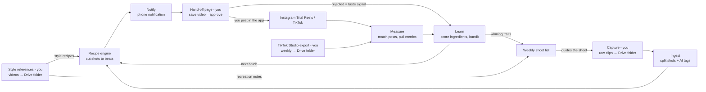

# After Wes Content Engine

A personal pipeline for the After Wes music project. You drop in raw footage, and it cuts that footage to song snippets and sends each finished video to your phone. You post the ones you like yourself, as Instagram Trial Reels and on TikTok. The system then finds those posts, reads back the results, and tells you which styles to double down on and what to shoot next.

**Design goal:** your effort goes into capturing good footage and tapping "post". The system handles the editing, experimenting and learning.

> Status: design phase. This README is the product spec (what and why). The engineering design, which governs all coding work, is in [docs/DESIGN.md](docs/DESIGN.md).

---

## Goals and non-goals

**Goals**
- Turn a folder of raw clips into beat-synced, 9:16 short videos with no manual editing.
- Run continuous style experiments on Instagram Trial Reels, which reach non-followers only.
- Learn which style "ingredients" win, and bias future edits toward them.
- Produce a weekly shoot list so capture effort is spent on what performs.
- Take in reference reels and TikToks you supply and turn their style into runnable recipes.
- **Nothing goes live unless you post it yourself from the Instagram or TikTok app.**

**Non-goals**
- Posting through any platform API, including drafts. The system never posts; it only reads metrics.
- Choosing which songs to promote. The system works with any snippet.
- Generative AI footage. Every frame is your own real footage.
- Downloading other creators' content, or scraping any platform. You source reference videos yourself, and stats come from official read-only APIs and exports.

---

## Your touchpoints

| When | What you do | Time |
| --- | --- | --- |
| Weekly | Shoot (guided by last week's shoot list) and upload clips to the Google Drive footage folder | your call |
| Once per song | Pick 2–4 snippets (15–20 s; hook, drop or build) | ~5 min |
| As you find them | Save a reel or TikTok you like and upload it to the Google Drive references folder | ~10 s each |
| Daily | Tap the phone notification, preview the video, **Save video** (that's the approval), then post it in the app; or Reject | ~1–2 min per video |
| Weekly | Download the TikTok Studio analytics export and drop it in the Drive exports folder | ~2 min |
| Weekly | Read the report and shoot list; graduate winning trials in the Instagram app | ~10 min |

---

## Architecture



The learning step has two outputs: **better edits** for the next batch, and a **shoot list** for you. Trial reels that win are graduated to your followers (by you, in the app, as the weekly report recommends), and their recipes are used for TikTok. That's how the system doubles down.

---

## Components

### 1. Ingest (Google Drive folder → shot library)
- **Source:** one Google Drive folder (e.g. `After Wes / Footage / Inbox`) that you upload to from your phone.
- **Detect new files:** poll the folder on a schedule with the Drive API (`files.list` filtered by parent folder and `mimeType contains 'video/'`).
- **Track state:** record each Drive `fileId` and its `md5Checksum`, so files are processed once and re-uploads are de-duplicated.
- **After processing:** move the file to a `Processed` subfolder, so the inbox shows only what's still pending.
- **Auth:** OAuth on your own Google account (`drive` scope).
- Split each raw file into shots with scene detection (PySceneDetect).
- Tag every shot with a vision model: subject, setting, motion, lighting, mood, and a quality score (shaky, blurry, dull).
- Store shots and tags in the shot library.

### 2. Snippets (song → beat grid)
- For each snippet you choose, run audio analysis (librosa, or madmom if needed) for tempo, beats, downbeats and the drop timestamp.
- Optional later: hook-finding suggestions. You make the final pick.

### 3. Recipe engine (shots + snippet + recipe → video)
Each video is one **recipe**, a set of style choices, applied to shots from the library and timed to the beat grid.

Assembly:
1. Select shots matching the recipe's filters.
2. Put the strongest shot in the first second.
3. Place cuts on the beat grid per the cut rate, with a hard cut on the drop.
4. Trim and reframe to 9:16, apply the look (LUT), burn in text.
5. Render locally with FFmpeg.

Recipe variables to parameterize from day one:

| Variable | Example values |
| --- | --- |
| `cut_rate` | every_beat · every_2_beats · downbeats · one_long_shot |
| `opening_shot` | most_motion · person_face · scenic · text_led |
| `footage_category` | city_night · nature · studio_performance · crowd · mixed |
| `length_s` | 7 · 12 · 20 |
| `on_screen_text` | none · hook_lyric · pov_caption |
| `snippet_type` | hook · drop · intro_build |
| `look` | natural · warm · high_contrast · bw |
| `effects` | none · zoom_punch_on_downbeat · speed_ramp · flash · shake |

Sketch of a recipe:

```json
{
  "id": "rcp_2b_drop_citynight_warm",
  "source": "generated | reference:<ref_id>",
  "cut_rate": "every_2_beats",
  "hard_cut_on_drop": true,
  "opening_shot": "most_motion",
  "footage_category": "city_night",
  "length_s": 12,
  "on_screen_text": "hook_lyric",
  "text_style": { "position": "lower_third", "case": "lower" },
  "snippet_type": "drop",
  "look": "warm",
  "effects": ["zoom_punch_on_downbeat"]
}
```

Every video targets Instagram Trial Reels. Some also target TikTok: one a day at first, then recipes proven on Instagram.

### 4. Hand-off and approval
- When a video is ready, you get a **phone notification** (ntfy). Tapping it opens the hand-off page, a small web page on your Mac reached privately over Tailscale.
- The page shows a preview, a **Save video** button, each platform's caption with a **Copy caption** button, and reminders (Instagram: turn on *Trial*; TikTok: add the official sound).
- **Saving the video is the approval.** Previewing doesn't count. On iPhone, Save opens the share sheet, so the video goes straight into Photos.
- **Reject** drops the video, with an optional reason tag. Videos not saved within 72 hours expire. Both feed the learning step as a taste signal.

### 5. Posting (you, in the app)
The system never posts. Instagram's API has no draft mode (anything uploaded through it goes live), so every video is handed to you instead. You post from the Instagram app (as a Trial Reel) or the TikTok app. This also means no posting-API audits or caps.

Matching each post back to its video: posting by hand leaves no ID linking the post to its video, so the system finds your recent posts through the read-only APIs and matches them on:
- posted after you saved that video;
- length within 0.5 s;
- caption similar to the one provided.

If a post isn't matched, paste its link (Share → Copy link) on the hand-off page.

### 6. Measure
- Pull metrics at 24 h and 72 h after each matched post, stored against the post and its recipe.
- **Instagram** (Meta Graph API, read-only): `views`, `reach`, `saved`, `shares`, `ig_reels_avg_watch_time`, `reels_skip_rate` ([reference](https://developers.facebook.com/documentation/instagram-platform/reference/instagram-media/insights)).
- **TikTok** (Display API, read-only): `view_count`, `like_count`, `comment_count`, `share_count` ([docs](https://developers.tiktok.com/doc/tiktok-api-v1-video-query)). No retention data.
- **TikTok watch time:** from the weekly TikTok Studio export you drop in Drive. The system imports it and links each row to its post. There's no scraping or browser automation.

### 7. Learn
- Treat recipes as arms in a multi-armed bandit (Thompson sampling), with about 80% exploit and 20% explore.
- Score each recipe **variable** separately, so the system learns which ingredients win, not just which video won.
- Compare trials only against other trials, since trials start slower than regular reels.
- Treat a variable value as settled only after about 8–10 posts.

| Signal | Source | Used to score |
| --- | --- | --- |
| Skip rate (lower is better) | IG API | Opening shot, snippet type |
| Avg watch time ÷ length | IG API | Cut rate, length, footage category |
| (Shares + saves) / reach | IG API | Tie-breaker |
| Avg watch time ÷ length | TikTok weekly export | TikTok scoring (lags about a week) |
| Shares / views | TikTok API | TikTok scoring until the export arrives |
| Views at 72 h | both | Distribution (noisy) |
| Saved / rejected / expired | hand-off page | Taste prior |

Doubling down:
1. Trials that beat the trial baseline are flagged in the weekly report, and you graduate them to followers in the app.
2. Winning recipes are re-rendered with fresh shots and handed off for TikTok.
3. Winning footage traits become shoot-list items.

### 8. Weekly report and shoot list
- Winners, losers, and confidence for each recipe variable.
- Trials worth graduating.
- The hand-off funnel (ready → saved → posted), plus any posts or export rows that need linking.
- Shoot list: concrete instructions, e.g. "more night city shots with motion toward camera; fewer static landscapes."
- Library gaps, e.g. "winning recipe needs low-angle handheld shots; you have 2."

### 9. Style reference intake
You save reels or TikToks you like and upload them to a dedicated Google Drive folder. The script picks up each new file and analyzes it. Downloading is entirely your call; the system never fetches anything from Instagram or TikTok.

**Intake (Google Drive references folder)**
- **Source:** a separate Drive folder, e.g. `After Wes / References / Inbox`.
- **Detection and state:** the same mechanism as footage ingest.
- **Optional context:** the system reads two optional fields if present:
  - **Note:** the Drive file's description field, or text in the filename after `--` (e.g. `zoom punches -- love the pacing.mp4`). It's used to steer the analysis.
  - **Source link or handle:** a URL or `@handle` in the description, stored for your reference only.
- **After analysis:** move the file to `References / Processed`. Keeping or deleting the original is a config option, defaulting to keep.

Pipeline:
1. **Measure:** scene detection for cut timestamps, beat tracking on its audio, color statistics, OCR for text, motion analysis for camera movement.
2. **Describe:** a vision model names shot types, transitions, effects and the opening hook.
3. **Style card:** a structured summary of the traits.
4. **Outputs:** (a) a recipe tagged `source: reference:<id>` that joins the bandit pool and must win on Trial Reels to stay; (b) recreation notes and shoot-list items for anything that has to be filmed.

| Trait | Extracted via | Automatable on your footage? |
| --- | --- | --- |
| Pacing (shot length, cuts per beat, cut on drop) | scene detection + beat grid | Yes |
| Length and structure | cut timing vs song sections | Yes |
| Color grade | color stats → LUT via color matching | Mostly |
| Text placement, size, case, timing | OCR + vision model | Yes (closest font) |
| Simple effects (ramps, zoom punch, flash, shake) | vision + motion analysis | Yes (FFmpeg filters) |
| Opening hook | vision model | Partly (needs a matching shot) |
| Camera work (handheld, whip pans, low angle, POV) | motion + vision | No → recreation notes |
| Subject and setting | vision model | No → shoot list |
| Complex VFX (masking, 3D tracking) | vision model can name them | No → notes only |

The system copies style, not content. Reference footage and audio are only measured, never reused in renders.

---

## Data model, stack and repo layout

These live in [docs/DESIGN.md](docs/DESIGN.md) (§4 layout, §5 data model, §8 config) so there's one source of truth. In short:
- **Language and runtime:** Python 3.12, run locally on the Mac via scheduled CLI jobs, and containerized so it can move to the cloud later.
- **Storage:** SQLite (SQLAlchemy + Alembic). Raw footage stays in Drive; shots and renders live in local storage.
- **Media:** FFmpeg, PySceneDetect, librosa, OpenCV, OCR.
- **AI:** Claude vision for shot tagging and reference analysis.
- **Hand-off:** a FastAPI page over Tailscale, with ntfy phone notifications.
- **Metrics:** Meta Graph API and TikTok Display API (read-only only), plus the weekly TikTok Studio export.

Secrets go in environment variables or `.env`, which is gitignored.

---

## Known constraints and risks

| Constraint | Impact | Mitigation |
| --- | --- | --- |
| Instagram API has no draft mode | Any API upload would go live | The system never posts; every video is handed off and posted by you |
| Manual posting leaves no link between post and video | Metrics can't be attributed automatically | Match on post time, length and caption; paste the link when it misses; track the match rate |
| TikTok has no trial/test mode | Every TikTok post is public to followers and the For You feed | Experiment on IG; TikTok gets proven recipes plus a small test share |
| No TikTok retention metrics via API | Weak TikTok signal | Weekly TikTok Studio export for watch time; learn style mostly from IG |
| TikTok Display API access for your own app | May need review before it can read your videos | Verify during setup; fall back to manual links + export-only scoring |
| Trial reels in the Meta API | Not yet confirmed that unposted-to-followers trials appear with insights | Verify during setup; manual links as fallback |
| Noisy metrics; `reels_skip_rate` is estimated and in development per Meta | False winners | Score ingredients over many posts |
| Taste is hard to automate | Off-brand edits | You choose what to save and post; rejections feed the scoring |
| No video-to-streams attribution | Can't measure streams directly | Use profile visits, link clicks and sound usage as proxies |
| Repetitive variants | Possible spam or unoriginal-content suppression | Fresh shots per render; cap repeats of a recipe per week |
| Label deals | A deal could restrict snippet use | Confirm terms before including a track |
| Reference video quality | Screen recordings and re-saves are compressed and may include UI overlays | Crop/ignore UI regions in analysis; treat grade and grain matching as approximate |
| Drive API quotas and large files | Slow or failed downloads of long 4K clips | Resumable downloads, retry with backoff, and process one file at a time |

---

## Roadmap

Build order is prototype first: each step works end to end before refinements are added. The detailed slices are in [docs/DESIGN.md §12](docs/DESIGN.md).

### Phase 1 — MVP
- [ ] Project skeleton (config, DB, CLI, Docker, CI)
- [ ] Google Drive auth + footage folder poller
- [ ] Scene split → vision tagging → shot library
- [ ] Snippet analysis (beats, downbeats, drop)
- [ ] 3 fixed recipes rendered with FFmpeg
- [ ] Phone notifications (ntfy)
- [ ] Hand-off page (preview, save = approve, reject, copy caption)
- [ ] Read-only Meta + TikTok access and post matching
- [ ] Metric pulls at 24 h and 72 h

### Phase 2 — Learning loop
- [ ] TikTok Studio weekly export import
- [ ] Per-variable scoring and Thompson sampling for batch generation
- [ ] Graduation recommendations
- [ ] Weekly report and shoot list

### Phase 3 — Style references
- [ ] References folder poller (reuses the Drive ingest client; reads optional note from description/filename)
- [ ] Reference analysis pipeline
- [ ] Style card → recipe conversion
- [ ] Recreation notes merged into the shoot list

### Phase 4 — Polish
- [ ] Text overlays and LUT looks
- [ ] Face-aware 9:16 reframing

---

## Open design questions

The live list is in [docs/DESIGN.md §14](docs/DESIGN.md). The main ones:
- What exactly does the TikTok Studio export contain? (Needs a sample before building the importer.)
- Do trial reels show up with insights in the Meta API?
- Can your own TikTok app read your videos without full app review?
- Is post matching accurate enough without extra signals?
- Captions and hashtags: templated, or generated per post?

---

## Existing tools (for reference)

| Tool | Relevance |
| --- | --- |
| [SongBlast](https://songblast.ai/) | Closest product: cuts your footage to your song and auto-posts. No experimentation loop. Worth a trial as a baseline. |
| [Summrs Auto Beat Sync](https://www.summrs.com/blog/how-to-make-music-promo-videos-with-ai) | Clips + song → beat-cut promo |
| [SoundRise](https://soundrise.io/) | Automated slideshow TikToks for songs |
| [Freebeat](https://freebeat.ai/music-promotion) | AI-generated beat-synced visuals (not your footage) |
| [CutClaw](https://github.com/cellinlab/CutClaw) | Open-source research: long footage + music → beat-synced edits |
| [CommandV](https://www.producthunt.com/products/commandv/reviews?page=2), [ReelMimic](https://aiindigo.com/tool/reelmimic), [AutoVio](https://auto-vio.github.io/autovio-docs/ui-guide/step-2-analyze) | Reference-style copying and analysis |
| [PostFast](https://postfa.st/blog/instagram-trial-reels), Publer, Later, Metricool | Schedulers that support IG Trial Reels |

None of these combine your own footage, structured experiments, learning, and a shoot-list feedback loop. That combination is what this project builds.
