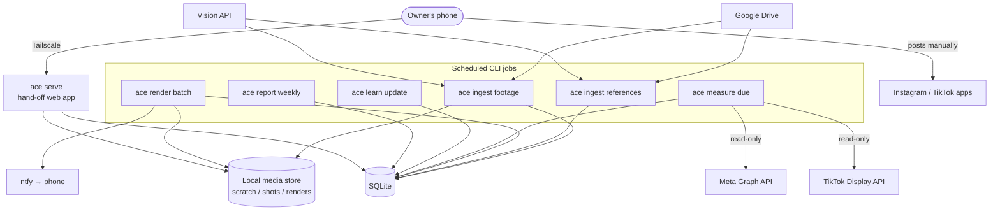
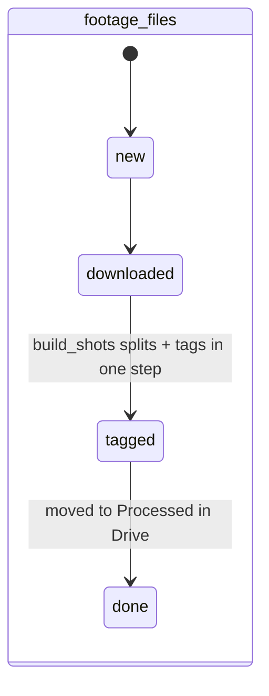
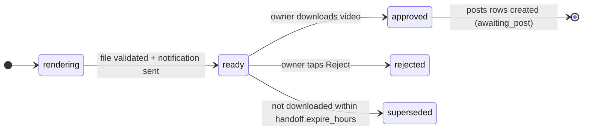
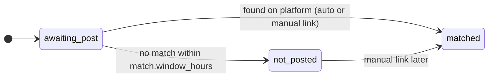

# Auto Content Engine — Design Document

> Status: **draft v0.2** (2026-11-08). This is the engineering reference for all coding work. The [README](../README.md) is the product spec: *what* and *why*. This document is the *how*: architecture, module contracts, data model, conventions and decisions. When code and this document disagree, fix one of them in the same change.

---

## 1. Decisions locked in

| # | Decision | Choice | Consequence |
| --- | --- | --- | --- |
| D1 | Runtime | **Local first, cloud-ready** | Runs on the Mac via launchd. All paths, credentials and storage go through config, and the app ships with a Dockerfile, so it can move to a scheduled cloud job without code changes. |
| D2 | Review UI | **Minimal hand-off web page** | FastAPI + server-rendered HTML. Reached from the phone over Tailscale (no public exposure). |
| D3 | Drive auth | **OAuth on the owner's Google account** | One-time browser consent, refresh token stored in the secrets dir. Scope: `drive`. |
| D8 | Posting | **Manual hand-off for every platform; the system never posts** | When a render is ready, the owner gets a phone notification. The hand-off page has the video and captions; the owner saves the video and posts it from the Instagram (as a Trial Reel) or TikTok app. No platform posting API is used. Supersedes D4/D4b. |
| D9 | Approval | **Downloading the video = approval** | There is no separate approve step. A download from the hand-off page moves the render to `approved`. |
| D10 | Phone notifications | **ntfy** (default; behind `Notifier`) | One HTTP POST per hand-off with a tap-through link. Swappable for Pushover/Telegram. |
| D5 | Language | Python 3.12 | Best fit for FFmpeg, librosa, PySceneDetect, OpenCV. |
| D6 | Database | SQLite via SQLAlchemy 2.0 + Alembic | Single file locally; same models move to Postgres in the cloud. |
| D7 | Orchestration | DB-driven idempotent jobs, triggered by CLI commands on a schedule | No queue broker. Each run picks up whatever work the DB says is due. |

New decisions get appended to the decision log in §13.

---

## 2. Design principles

1. **The database is the source of truth for pipeline state.** Every unit of work (a footage file, a render, a post, a metric checkpoint) has a row with a `status`. Jobs query for rows in a given state, do the work, and advance the state. A crash mid-run loses nothing; the next run resumes.
2. **Every job is idempotent and re-runnable.** Running `ace ingest` twice in a row does nothing the second time. Dedup keys are explicit (Drive `fileId` + `md5Checksum`, recipe param hash, etc.).
3. **Pure core, thin edges.** Decisions (shot selection, beat-grid cutting, post matching, bandit sampling, scoring) are pure functions over plain data and are unit-tested without I/O. External systems (Drive, vision API, FFmpeg, notifications, Meta, TikTok) sit behind small interfaces with fakes for tests.
4. **Plan, then execute.** Rendering is split into building a `Timeline` (pure data: which shot, which in/out points, which effects, at which output times) and executing it with FFmpeg. The timeline is stored with the render, so any video can be explained and reproduced.
5. **One failure doesn't block the batch.** Per-item errors are recorded on the row (`error`, `attempts`) and the job moves on. Items past `max_attempts` go to `failed` and show up in the report.
6. **The system never posts.** No code calls a platform's publish, upload or draft endpoint. Platform APIs are used **read-only**, for metrics. Every post goes live only when the owner publishes it from the platform's app. This is a hard rule: don't add a posting client, even behind a flag.
7. **No secrets or personal paths in code or git.** Everything environment-specific comes from config.

---

## 3. System overview



Two long-lived processes at most: the scheduler (launchd locally, cron/cloud scheduler later) that invokes CLI jobs, and `ace serve` for the hand-off page. Everything else is a short-lived command.

### Default schedule

| Job | Cadence | Notes |
| --- | --- | --- |
| `ace ingest footage` | every 30 min | Poll, download, split, tag. |
| `ace ingest references` | every 30 min | Phase 3. |
| `ace ingest exports` | daily | Imports TikTok Studio export files from Drive (§7.6). |
| `ace render batch` | daily, 06:00 | Renders N candidates (config: `cadence.renders_per_day`, default 4). Their notifications are held until the 4–7 pm ET posting window (§7.5). |
| `ace notify pending` | every 15 min, 16:00–19:00 ET | Sends the held hand-off notifications. Morning batch renders only notify on a run inside the window. |
| `ace measure due` | hourly | Matches newly posted videos to renders, then pulls any due 24 h / 72 h checkpoints. |
| `ace learn update` | daily, after measure | Recomputes variable scores. Phase 2. |
| `ace report weekly` | Mondays 07:00 | Report + shoot list. Phase 2. |

---

## 4. Repository layout

The README's proposed layout, made concrete. The installable package is `engine`; the CLI entry point is `ace`.

```
auto-content/
├── README.md                  # product spec
├── CLAUDE.md                  # instructions for coding sessions
├── docs/
│   ├── DESIGN.md              # this document
│   └── runbooks/              # setup: Google OAuth, Meta app (read-only), TikTok app (read-only), ntfy, Tailscale
├── pyproject.toml             # deps, ruff, mypy, pytest config; `ace` console script
├── uv.lock
├── Dockerfile                 # cloud-ready image (python + ffmpeg)
├── .env.example               # every env var, no values
├── config/
│   ├── default.toml           # cadence, recipe space, thresholds (no secrets)
│   └── luts/                  # .cube files for `look`
├── alembic/                   # migrations
├── engine/
│   ├── cli.py                 # Typer app; one subcommand per job
│   ├── config.py              # Settings (pydantic-settings): TOML + env
│   ├── db/                    # SQLAlchemy models, session, repositories
│   ├── storage/               # MediaStore (local now, bucket later)
│   ├── ffmpeg.py              # shared ffmpeg/ffprobe subprocess wrapper
│   ├── http.py                # shared HTTP client with retries/backoff
│   ├── log.py                 # JSON logging setup
│   ├── drive/                 # DriveClient: list / download / move
│   ├── vision/                # VisionTagger interface + Claude implementation, prompts
│   ├── ingest/                # footage poller, scene split, shot tagging
│   ├── snippets/              # beat / downbeat / drop analysis
│   ├── recipes/               # Recipe model, recipe space, shot selection, timeline assembly
│   ├── render/                # Timeline → FFmpeg command, LUTs, text, effects
│   ├── references/            # reference analysis → style card → recipe + notes
│   ├── handoff/               # FastAPI hand-off app, templates, download = approval
│   ├── notify/                # Notifier interface + ntfy implementation
│   ├── measure/               # PlatformReader interface (Meta, TikTok), post matching, metric pulls
│   └── learn/                 # scoring, Thompson sampling, report, shoot list
├── data/                      # gitignored: sqlite db, media store, secrets
├── scripts/                   # one-off dev helpers only (jobs belong in the CLI)
└── tests/
    ├── unit/                  # pure logic, no I/O
    ├── integration/           # real ffmpeg / sqlite against tiny fixtures
    ├── fakes/                 # in-memory Protocol implementations
    └── fixtures/              # generated test clips + audio (see §11)
```

Dependency direction: `cli` → feature modules (`ingest`, `recipes`, …) → shared infrastructure (`db`, `storage`, `drive`, `vision`, `notify`, `config`). Feature modules don't import each other's internals; they communicate through the DB and the per-module contract models (`engine/<module>/models.py`).

Each module owns its CLI commands in `engine/<module>/cli.py`, which `engine/cli.py` mounts. `ace auth google` lives in `drive/cli.py`, `ace auth meta|tiktok` and `ace posts link` in `measure/cli.py`, and `ace report weekly` in `learn/cli.py`.

---

## 5. Data model

Refinements over the README's first pass:

- `references` is a reserved word in SQL → table is **`style_references`**.
- Songs and snippets are split, so a song's audio is analyzed once and snippets are ranges on it.
- Every processed item carries `status`, `error`, `attempts`, `updated_at` for the job pattern in §2.
- Recipes are identified by a **hash of their canonical params**, so the same style choices always map to the same recipe row.
- A render has **target platforms** and a caption per target. A `posts` row per target is created at approval (download) and later **matched** to the video the owner actually posted.
- Metrics keep the raw API payload, so new signals can be derived later without re-fetching.
- Variable scores are keyed by platform, since IG and TikTok signals differ.

```
footage_files
  id PK, drive_file_id UNIQUE, md5, name, size_bytes, local_path,
  status [new|downloaded|split|tagged|done|duplicate|failed], error, attempts,
  created_at, updated_at

shots
  id PK, footage_file_id FK, start_s, end_s, duration_s,
  width, height, fps, orientation [portrait|landscape|square],
  category, subject, setting, lighting, mood,          -- from vision tags
  motion_score REAL, quality_score REAL,                -- 0..1
  has_face BOOL, tags_json, thumbnail_path, proxy_path,
  use_count INT DEFAULT 0, last_used_at,
  created_at

songs
  id PK, title, audio_path, duration_s, bpm, beats_json, downbeats_json,
  analyzed_at

snippets
  id PK, song_id FK, label, snippet_type [hook|drop|intro_build],
  start_s, end_s, drop_s NULL, active BOOL, created_at

recipes
  id PK (e.g. "rcp_" + first 12 hex of sha256(canonical params)),
  params_json, source ["generated" | "reference:<id>"], active BOOL, created_at

renders
  id PK, recipe_id FK, snippet_id FK, timeline_json, shot_ids_json,
  file_path, duration_s, targets_json,                  -- e.g. ["ig_trial"] or ["ig_trial","tiktok"]
  captions_json,                                        -- {platform: caption}
  status [rendering|ready|approved|rejected|superseded|failed],
  notified_at, downloaded_at, download_count,
  reject_reason NULL, reject_note NULL, reviewed_at,
  ffmpeg_argv_json, error, attempts, created_at, updated_at

posts
  id PK, render_id FK, platform [ig_trial|tiktok],
  status [awaiting_post|matched|not_posted],
  external_id NULL, permalink NULL, posted_at NULL,
  match_method [auto|manual] NULL, match_score REAL NULL,
  created_at, updated_at, UNIQUE(render_id, platform)

metrics
  id PK, post_id FK, checkpoint [24h|72h|export], source [api|export], fetched_at,
  views, reach, likes, comments, shares, saves,
  avg_watch_s, full_watch_rate, skip_rate, raw_json,
  UNIQUE(post_id, checkpoint)                           -- the `export` row is overwritten by each newer export

metric_imports                                          -- TikTok Studio export files (§7.6)
  id PK, drive_file_id UNIQUE, md5, name, platform,
  status [new|imported|failed], rows_total, rows_matched, rows_unmatched,
  error, created_at

variable_scores
  variable, value, platform, alpha REAL, beta REAL, n_posts INT, updated_at,
  PK(variable, value, platform)

style_references
  id PK, drive_file_id UNIQUE, md5, name, note, source_link,
  status [new|downloaded|analyzed|failed], error, attempts,
  style_card_json, recipe_id FK NULL, recreation_notes, created_at, updated_at
```

Schema changes go through Alembic migrations, never hand edits to the DB. The SQLite file is `data_dir/db/engine.sqlite3`. Enums are stored as plain strings, so adding a value needs no migration. Datetime columns accept only timezone-aware UTC values.

### State machines



**Render**



**Post**



Any processing state can move to `failed` once `attempts >= max_attempts`. The local download is deleted once a footage file reaches `done`; shots are re-cut from Drive if ever needed (scratch is disposable). Render files are kept until every post for that render is `matched` or `not_posted` + `renders.keep_days`.

---

## 6. Module contracts

Interfaces are `typing.Protocol`s. Each has a real implementation and an in-memory fake under `tests/fakes/`.

```python
class DriveClient(Protocol):
    def list_videos(self, folder_id: str) -> list[DriveFile]: ...
    def download(self, file_id: str, dest: Path) -> Path: ...          # resumable, retries
    def move(self, file_id: str, to_folder_id: str) -> None: ...

class VisionTagger(Protocol):
    def tag_shot(self, frames: list[Path]) -> ShotTags: ...            # 3 frames: start/mid/end
    def describe_reference(self, frames: list[Path], note: str | None) -> ReferenceDescription: ...

class MediaStore(Protocol):                                             # local disk now, bucket later
    def path_for(self, kind: str, name: str) -> Path: ...

class Notifier(Protocol):
    def send(self, notification: Notification) -> None: ...            # title, body, click_url, tags

class PlatformReader(Protocol):                                         # read-only; no posting methods
    platform: Platform
    def recent_videos(self, since: datetime) -> list[PlatformVideo]: ...   # id, permalink, posted_at, caption, duration_s
    def fetch_metrics(self, external_id: str) -> MetricSnapshot: ...
```

Domain models (`DriveFile`, `ShotTags`, `Recipe`, `Timeline`, `Notification`, `PlatformVideo`, `MetricSnapshot`, …) are Pydantic v2 models. Vision API responses are parsed into these models and rejected if they don't validate; the shot is retried, never stored half-tagged.

`PlatformReader` deliberately has no write methods (principle 6).

---

## 7. Pipeline stages

### 7.1 Ingest (Phase 1)
1. `list_videos(inbox_folder)`; insert unseen `drive_file_id`s as `new`. A file whose `md5` matches an existing row is marked a duplicate and moved without processing.
2. Download to `data/media/scratch/` (resumable, exponential backoff, one file at a time).
3. Normalize: probe with `ffprobe`; record rotation, fps, resolution.
4. Split with PySceneDetect (`ContentDetector`, threshold in config). Drop shots shorter than `ingest.min_shot_s` (default 0.8 s). Split shots longer than `ingest.max_shot_s` (default 8 s) into sub-shots so selection has granularity.
5. Per shot: extract 3 frames, compute `motion_score` (OpenCV optical flow magnitude, normalized) and a blur/shake heuristic locally, then call `VisionTagger.tag_shot` for semantic tags + quality. Final `quality_score` combines both.
6. Encode a **proxy** for each shot (H.264, already center-cropped to 9:16, width capped at 1080 px) into `data/media/shots/`. Renders only scale the proxy to the output size; the cover-crop in render is then a no-op. Renders read proxies, not originals, so renders don't depend on Drive.
7. Move the Drive file to `Processed`; status `done`.

Vision tag vocabulary (`category`, `lighting`, etc.) is a closed enum defined in `config/default.toml` and included in the prompt, so tags stay matchable against recipe filters.

### 7.2 Snippets (Phase 1)
- `ace snippets add <audio> --start --end --type` (song audio is a local file the owner provides; not in Drive for v1).
- Song analysis with librosa: tempo, beat times, downbeats (librosa beats + bar estimation; swap to madmom if downbeats prove unreliable). Drop detection: largest positive jump in onset-strength/RMS envelope inside the snippet, snapped to the nearest downbeat. The owner can override `drop_s`.
- Outputs a `BeatGrid` (pure data) for the snippet window, times relative to snippet start.
- As built:
  - The beat grid assumes a constant tempo. librosa's beats are refined by a line fit and extended over the whole song; songs with tempo changes would need madmom.
  - Songs are cached by resolved file path.
  - `snippets.drop_s` is stored as absolute song time, like `start_s`/`end_s`.
  - The drop is auto-detected for every snippet type unless `--drop` is given: the largest RMS rise of at least 3 dB, snapped to a downbeat.

### 7.3 Recipes and assembly (Phase 1)
- `Recipe` is a Pydantic model whose fields are the README's recipe variables, each an enum. The **recipe space** (allowed values per variable) lives in config.
- `select_shots(recipe, library, beat_grid, rng) -> list[Shot]`: filter by orientation (a render never mixes portrait and landscape shots), category and quality floor, exclude shots used in the last `recipes.shot_cooldown_days`, rank by recipe's `opening_shot` criterion for slot 0.
- `assemble(recipe, shots, beat_grid) -> Timeline`: compute cut points from `cut_rate`, force a cut on `drop_s` if `hard_cut_on_drop`, fit total length to `length_s` (snapped to the nearest beat), assign shots to slots (a shot must be at least as long as its slot, or it's skipped for that slot), attach effects keyed to beat/downbeat times, attach text events.
- As built:
  - No cut lands within 0.1 s of another cut or of the ends.
  - Effects are keyed to downbeats, except `shake`, which is on every beat.
  - Segments always start at the proxy's beginning.
  - `plan_batch` writes nothing. The render integration inserts the `recipes` row and updates the shots' `use_count`/`last_used_at`.
- Both functions are pure and deterministic given a seeded `rng`. These are the most heavily unit-tested functions in the codebase.
- **Targets:** every render targets `ig_trial`. It also targets `tiktok` when its recipe is proven on IG (Phase 2) or when config forces it (`cadence.tiktok_every_render`, default false). In Phase 1, one render a day also targets TikTok.

Phase 1 ships **6 fixed recipes** from config: 3 styles, each in a portrait and a landscape version (`footage_orientation`). Landscape shots are center-cropped to 9:16. Phase 2 replaces fixed recipes with sampling (§7.7).

### 7.4 Render (Phase 1)
- `render(timeline, snippet_audio, out_path)` builds a single FFmpeg filter graph: per-segment `trim` → reframe to 1080×1920 (center crop; face-aware crop is a later improvement) → effects → `concat` → LUT (`lut3d`) → text (`drawtext` with bundled fonts; see "Native-looking text" below) → mux snippet audio → H.264 High / AAC, 30 fps, `+faststart`.
- The exact FFmpeg argv is logged and stored alongside the render for reproducibility.
- As built:
  - Effects are applied after concat, keyed to output time.
  - `execute_plan` retries inside one call, up to `render.max_attempts`, so a render row always ends in `ready` or `failed`.
  - The bundled default font is Anton (SIL OFL 1.1). The native-text task adds TikTok Sans.
  - Text needs an ffmpeg build with `drawtext` (libfreetype). The Homebrew `ffmpeg` formula doesn't include it; `ffmpeg-full` does, and the Docker/Debian image does.
- Output validated with `ffprobe` (duration within ±1 frame of plan, 9:16, has audio).
- Captions per target, templated from config for v1 (open question in §14).
- **Native-looking text** (follow-up task after slice 6): burned-in text should look like text added in the app.
  - **Fonts:** bundle **TikTok Sans** (TikTok's own app font, open source under SIL OFL 1.1). Instagram's in-app font (Instagram Sans) isn't openly licensed, so the IG preset uses the closest OFL match, and the owner can drop their own font file into `data_dir/fonts/` and point the preset at it.
  - **Styles:** presets copy the in-app looks: plain white with a soft shadow, outline, and a rounded background box (white box with black text, or black with white). Text sits inside the platform safe zones, clear of the caption and button overlays.
  - **Text source:** `ace snippets add --text "<hook lyric>"` stores the hook text on the snippet, and recipes with `on_screen_text = hook_lyric` use it.
- On success: status → `ready`, then send the hand-off notification (§7.5). If the notification fails, the render stays `ready` with `notified_at` NULL, and the next run retries the notification.

### 7.5 Hand-off and approval (Phase 1)

**Notification.** A `Notification` per ready render through `Notifier` (ntfy: `POST https://ntfy.sh/<topic>` or a self-hosted server). Fields: title `"Hand-off ready: <song> · <recipe short name>"`, body with length and targets, `Click` header = the hand-off page URL (Tailscale hostname), tag for the platform icons. The topic name is a long random string kept in secrets (anyone who knows a public ntfy topic can read it). **Posting window:** the owner posts only in prime time, 4–7 pm US Eastern (`America/New_York`, so it follows DST). This is set as quiet hours from 19:00 to 16:00 in `notify.quiet_hours`. Notifications due inside quiet hours are held until 16:00, so every hand-off arrives during the posting window.

**Hand-off page** (`ace serve`, FastAPI on the Mac, reached over Tailscale). Auth: a long random token in a cookie set once via `/login?token=…`; Tailscale is the network boundary.
- `/` lists `ready` renders (newest first) and recent `approved` ones awaiting a post.
- `/handoff/{render_id}` shows:
  - a video preview, served from `/handoff/{id}/preview` (HTTP Range support for scrubbing). **Previewing is not approval.**
  - a **Save video** button.
  - one card per target platform, with its caption and a **Copy caption** button, plus short posting reminders (IG: turn on *Trial*; TikTok: add the official sound if it's a song-driving post).
  - a **Reject** button with reason chips (`off_brand`, `bad_shot`, `bad_timing`, `bad_text`, `boring`, `other`) + optional note.
  - after approval, a **Link post** field to paste the post URL if auto-matching misses it (§7.6).
- **Download = approval.** *Save video* calls `/handoff/{id}/download`. The server records `downloaded_at`, increments `download_count`, moves the render `ready → approved` (only on the first download) and creates one `posts` row per target in `awaiting_post`, all in one transaction. Then it returns the file. On phones that support the Web Share API with files (iOS Safari), the page fetches that endpoint and opens the share sheet, so *Save Video* puts it straight into Photos. Otherwise it's a plain `Content-Disposition: attachment` link. Repeat downloads are allowed and don't create duplicate posts.
- A rejected or superseded render can't be downloaded (the button is gone; the endpoint returns 409).
- Renders not downloaded within `handoff.expire_hours` (default 72) become `superseded`. Superseded counts as a weak negative in the taste prior (weight in config, default 0.25 of a reject).
- Templates are plain Jinja + minimal CSS + a few lines of vanilla JS for share/copy; no JS framework.

### 7.6 Post matching and metrics (Phase 1)

Since the owner posts by hand, the system has to find each post on the platform and link it back to its render. All platform calls are read-only.

**Platform readers**
- **Instagram** (Meta Graph API, Instagram Business/Creator account). `GET /{ig-user-id}/media` with fields `id, permalink, timestamp, caption, media_type, media_product_type`, and per-media insights (`views`, `reach`, `saved`, `shares`, `ig_reels_avg_watch_time`, `reels_skip_rate`). Read scopes only (insights + basic). Long-lived token refresh is a scheduled check; the job fails loudly a week before expiry. *To verify in setup:* trial reels appear in the media list with insights before graduation (see §14).
- **TikTok** (Display API via the owner's own developer app, Login Kit, scopes `user.info.basic` + `video.list`). `POST /v2/video/list/` returns `id, create_time, video_description, duration, share_url` plus `view_count, like_count, comment_count, share_count`. No watch-time or retention data. Reading needs no posting audit. *To verify in setup:* the app can be approved, or used in sandbox, for the owner's own account (see §14). The Display API is used for matching and for the 24 h / 72 h count checkpoints.
- **TikTok watch time: weekly TikTok Studio export.** Once a week the owner downloads the per-post analytics export from TikTok Studio (desktop) and drops it in a Drive folder (`Content Engine / TikTok Exports / Inbox`). `ace ingest exports` reuses the Drive poller (same `fileId` + `md5` dedup, moved to `Processed` after import), parses the file and joins each row to a matched TikTok post by video ID/link. If the export has no ID column, it falls back to post date + caption text against matched posts. Each joined row upserts that post's `export` metrics row (`avg_watch_s`, `full_watch_rate`, plus the counts). Rows that don't join are counted on `metric_imports.rows_unmatched` and listed in the weekly report. No scraping or browser automation of TikTok or Instagram.

As built:
- Instagram's media API returns no duration, so the duration filter is skipped for IG candidates.
- `ace auth meta` swaps a short-lived Graph API Explorer token (read scopes) for a ~60-day token; the owner re-runs it when warned.
- Manual links are resolved to the numeric IG media id and `posted_at` on the next `ace measure due`.

**Matching** (`ace measure due`, step 1): for each platform with `awaiting_post` rows:
1. Fetch the platform's videos posted since the oldest `downloaded_at` among those rows (minus 1 h slack).
2. Drop videos already linked to a post.
3. `match_posts(awaiting, candidates) -> list[Match]` is a pure function. Scoring per (post, video) pair:
   - **hard filters:** posted after `downloaded_at`, and duration within `match.duration_tolerance_s` (default 0.5 s) of `renders.duration_s`;
   - **score:** caption similarity (normalized token overlap against the provided caption, since the owner may edit it) plus time proximity to download.
   - Assign greedily by best score with a uniqueness constraint. A pair below `match.min_score` stays unmatched.
4. Matched → `matched` with `external_id`, `permalink`, `posted_at`, `match_method=auto`, `match_score`.
5. Still unmatched after `match.window_hours` (default 72 after download) → `not_posted`. The hand-off page's *Link post* field sets `matched` with `match_method=manual` at any time.

**Metrics** (step 2): matched posts where `posted_at + 24h/72h <= now` and that checkpoint row is missing → `fetch_metrics` → insert. Fields a platform doesn't return stay NULL.

### 7.7 Learn (Phase 2)
- **Reward per post** (IG trials): `success = 1` if the post beats the rolling **trial baseline** (median of the last `learn.baseline_window` trials, default 30) on the primary metric for that variable (table below), else 0. Binary rewards keep the Beta-Bernoulli model simple and robust to noisy magnitudes.
- **Per-variable scoring:** each matched post updates `(variable, value, platform)` Beta posteriors for every variable in its recipe. Approval signals update a separate `internal` platform row as a taste prior: approved (downloaded) = success; rejected = failure; superseded = weighted failure. A render that was downloaded but never posted (`not_posted`) is neutral.

  | Variable(s) | Primary metric |
  | --- | --- |
  | `opening_shot`, `snippet_type` | skip rate (lower wins) |
  | `cut_rate`, `length_s`, `footage_category`, `footage_orientation`, `look`, `effects`, `on_screen_text` | avg watch time ÷ length |
  | tie-breaker | (shares + saves) / reach |

  TikTok posts update the `tiktok` platform rows against a TikTok-only baseline. They're scored on avg watch time ÷ length from the latest `export` row once one exists, and on shares / views from the API checkpoints until then. Because exports arrive weekly, TikTok scores lag about a week behind IG.

- **Batch generation:** for each render slot, with probability 0.8 build a recipe by Thompson-sampling each variable independently from its posterior (exploit); with 0.2 pick uniformly (explore). The taste prior multiplies in as a soft weight (a reject-heavy value is down-weighted, not banned). Reference recipes enter as whole recipes in the explore share.
- A value is "settled" when `n_posts >= 8` and the posterior's 90% interval excludes the baseline.
- Guardrail: no recipe hash rendered more than `recipes.max_repeats_per_week` (default 3).
- Graduation of trial reels to followers is done by the owner in the Instagram app. The weekly report recommends which trials to graduate.

### 7.8 Weekly report and shoot list (Phase 2)
- Report rendered to HTML (served at `/report/<week>` by `ace serve`, with a notification when it's ready) plus a short summary.
- Contents: winners, losers and confidence per variable; trials worth graduating; hand-off funnel (ready → downloaded → posted); unmatched posts to link.
- Shoot list = winning footage traits (`category`, `setting`, `lighting`, high-motion vs static) × library gaps (count of high-quality shots matching each winning trait, vs what next week's planned recipes need). Generated text is templated from structured findings; an LLM may phrase it, but the numbers come from the DB.

### 7.9 Style references (Phase 3)
Reuses the Drive poller with the references folder. Measurement (scene cuts, beat tracking, color stats, OCR, motion) is local; the vision model fills in the semantic parts. Output is a `StyleCard` model, mapped to the nearest point in the recipe space → `recipes` row with `source=reference:<id>`, plus `recreation_notes` for traits the system can't produce. Reference media is never used in renders; only measurements are kept.

---

## 8. Configuration and secrets

- `engine/config.py` defines a single `Settings` object (pydantic-settings). Precedence: env vars > `config/local.toml` (gitignored) > `config/default.toml`.
- Paths: `data_dir` (default `./data`), with `db`, `media/scratch`, `media/shots`, `media/renders`, `secrets` beneath it. Nothing outside `data_dir` is written.
- Secrets, env only (`.env` locally, secret manager in the cloud):
  - `GOOGLE_OAUTH_CLIENT_JSON`, `ANTHROPIC_API_KEY`;
  - `META_APP_ID`, `META_APP_SECRET`, `META_IG_USER_ID`;
  - `TIKTOK_CLIENT_KEY`, `TIKTOK_CLIENT_SECRET`;
  - `NTFY_SERVER` (default `https://ntfy.sh`), `NTFY_TOPIC`, `NTFY_TOKEN` (optional);
  - `HANDOFF_BASE_URL` (Tailscale URL), `HANDOFF_TOKEN`.

  OAuth refresh tokens are written to `data/secrets/` with `0600` permissions.
- Vision model id is config (`vision.model`, default `claude-sonnet-5-5`), never hardcoded.

### Cloud-readiness checklist
Kept true from day one so a move is a deploy, not a refactor:
- [ ] No absolute or Mac-specific paths; everything under `data_dir`.
- [ ] `Dockerfile` builds and `ace --help` runs in it (CI check).
- [ ] `MediaStore` is the only code touching media file locations (in the cloud, the hand-off download becomes a signed bucket URL, and the approval is recorded before the redirect).
- [ ] DB URL is config; no SQLite-only SQL in queries.
- [ ] Jobs are single-shot commands, so any scheduler can run them.

---

## 9. Coding conventions

- **Tooling:** `uv` for env and deps; `ruff` (lint + format); `mypy --strict` on `engine/`; `pytest`. `make check` (or `uv run task check`) runs all four and must pass before a commit.
- **Style:** readable names over abbreviations; small functions; match surrounding code. Comments only for non-obvious *why*. Type hints everywhere in `engine/`.
- **Models:** Pydantic for domain models and anything crossing a boundary (API payloads, config, JSON columns). SQLAlchemy models stay in `engine/db`; convert to domain models at the repository layer.
- **Time:** all timestamps UTC, timezone-aware. Media times are `float` seconds; frame-accurate math rounds to the output fps in one helper.
- **Randomness:** any function that samples takes an explicit `random.Random` (or numpy `Generator`). No global RNG.
- **Subprocesses:** FFmpeg/ffprobe are called through one wrapper that logs argv, captures stderr, and raises a typed error with the stderr tail.
- **External HTTP:** one client per service, with timeouts, retries with exponential backoff on 429/5xx, and no retry on 4xx. Rate limits live in config.
- **Logging:** stdlib `logging` with JSON output; every log line in a job includes the job name and the row id it is working on. Never log tokens, the ntfy topic or the hand-off token.
- **Errors:** expected failures (scene split finds zero shots, a notification fails) are recorded on the row; unexpected exceptions are logged with traceback, recorded, and the job continues with the next item.
- **Git:** small commits, one concern each; migrations committed with the model change that needs them.

---

## 10. CLI surface

```
ace init                        # create data dirs, run migrations, check ffmpeg
ace auth google | meta | tiktok # one-time OAuth flows (meta/tiktok are read-only scopes)
ace ingest footage | references | exports
ace snippets add <audio> --start S --end S --type hook|drop|intro_build
ace snippets list
ace render batch [--n N] [--recipe ID] [--snippet ID] [--dry-run]   # dry-run prints timelines, no notifications
ace render one --recipe ID --snippet ID                            # dev loop
ace notify test                 # send a test notification to the phone
ace notify pending              # send hand-off notifications for ready renders (respects the posting window)
ace serve [--host --port]       # hand-off page (bind 127.0.0.1, expose with `tailscale serve --bg 8000` for HTTPS)
ace measure due                 # match posts, then pull due metrics
ace posts link <render_id> <platform> <url>                        # manual match
ace learn update
ace report weekly
ace status                      # counts per table/status, recent failures
```

---

## 11. Testing strategy

| Layer | What | How |
| --- | --- | --- |
| Unit | beat grid → cut points, drop snapping, shot selection, `assemble`, render/post state transitions, `match_posts`, bandit sampling and updates, reward computation, recipe hashing | Pure functions; seeded RNG; property tests (Hypothesis) for timeline invariants: total duration = target, every cut on the grid, no shot reused within a video, a cut at the drop when required |
| Integration | scene split, FFmpeg render, ffprobe validation, DB repositories, migrations, hand-off endpoints (download → approval exactly once, preview ≠ approval, 409 on rejected) | Real ffmpeg + temp SQLite against tiny fixtures; FastAPI `TestClient` |
| Contract | Drive, vision, ntfy, Meta, TikTok clients | Recorded responses (respx/vcrpy); fakes implement the same Protocols |
| End-to-end (local) | `ingest → render → notify → download → measure (match + metrics)` | One test against fakes, run in CI |

A guard test asserts that no module under `engine/` imports or calls a known publish endpoint (Meta `media_publish` / `/media` POST, TikTok `/post/publish/`), enforcing principle 6.

Fixtures are **generated, not committed binaries**: a `tests/fixtures/make_fixtures.py` builds a few short clips with ffmpeg `lavfi` (color bars, moving test patterns, hard scene changes) and a click track at a known BPM, so beat and scene detection have ground truth.

Tests are written first and must fail before the code is written. The workflow is in [CLAUDE.md](../CLAUDE.md#test-first-workflow).

No test touches the network. CI: GitHub Actions on push (`make check` + Docker build).

---

## 12. Milestones (Phase 1 broken into shippable slices)

Each slice ends with something runnable and tested.

1. **Skeleton**: pyproject, config, DB + first migration, CLI with `init`/`status`, Dockerfile, CI.
2. **Drive ingest**: OAuth, poller, dedup, download, move to Processed.
3. **Shot library**: scene split, proxies, motion/quality heuristics, vision tagging.
4. **Snippets**: `snippets add`, beat grid, drop detection.
5. **Assembly**: Recipe model, 3 fixed recipes, selection + `assemble` → Timeline (`render batch --dry-run`).
6. **Render**: FFmpeg pipeline, LUTs, text, validation.
7. **Notify**: `Notifier` + ntfy, quiet hours, retry of unsent notifications, `ace notify test`.
8. **Hand-off page**: `ace serve`, preview, save/share, download = approval, reject, expiry, Tailscale runbook.
9. **Platform readers**: Meta + TikTok read-only auth, `recent_videos`, `match_posts`, manual link.
10. **Measure**: 24 h / 72 h metric pulls.

Phase 2 starts with **TikTok export import** (`ace ingest exports`, `metric_imports`, join to posts), since it only matters once learning uses TikTok watch time.

Phases 2–4 follow the README roadmap; each gets broken into slices here before work starts. Build order follows the prototype-first rule: get each slice working end to end before adding refinements, and add a refinement only when real usage shows the simpler version falls short.

---

## 13. Decision log

| Date | ID | Decision | Why |
| --- | --- | --- | --- |
| 2026-11-08 | D1 | Local first, cloud-ready | Cheapest and easiest to debug; config/storage abstraction + Dockerfile keep the move cheap. |
| 2026-11-08 | D2 | Minimal FastAPI page over Tailscale | Full control of the review UX; Tailscale avoids exposing the Mac publicly. |
| 2026-11-08 | D3 | Drive OAuth on owner account | Owner uploads the files, so owner auth can move them; one-time setup. |
| 2026-11-08 | D4 | ~~TikTok inbox drafts via own app~~ | Superseded by D4b, then D8. |
| 2026-11-08 | D4b | ~~TikTok via Upload-Post~~ | Superseded by D8. Research notes, in case API posting is ever reconsidered: Upload-Post Basic ($24/mo) supports TikTok direct + draft posts and IG trial reels (`share_mode`); alternatives are Zernio, Blotato and Ayrshare. |
| 2026-11-08 | D8 | Manual hand-off for all platforms; system never posts | Owner requirement: nothing goes live without the owner posting it from the app. Instagram's API has no draft mode (any API upload goes live), so a hand-off is the only way to meet this for IG. Doing the same for TikTok keeps one workflow and removes posting-API dependencies, audits and caps. |
| 2026-11-08 | D9 | Download from the hand-off page = approval | One touch per video; the download is a clear, server-observable intent signal. |
| 2026-11-08 | D10 | ntfy for phone notifications | Free, iOS + Android, one HTTP POST with a click URL. Behind `Notifier`, so swappable. |
| 2026-11-08 | D6 | SQLite + SQLAlchemy + Alembic | Zero-ops now, Postgres-compatible later. |
| 2026-11-08 | D7 | DB-driven jobs, no broker | Volume is tiny (a few renders/day); a queue adds ops with no benefit. |
| 2026-11-08 | — | Binary reward vs rolling trial baseline for the bandit | Metrics are noisy and differently scaled; a Beta-Bernoulli per variable is simple and robust. Revisit with more data. |
| 2026-11-08 | — | Render from local proxies, not Drive originals | Renders become fast and independent of Drive availability. |
| 2026-11-08 | — | Match manual posts by duration + caption similarity + time, with manual link fallback | No ID links a hand-posted video to its render; these signals are available from both read APIs. Frame-fingerprint matching was considered and deferred until the match rate shows it's needed. |
| 2026-11-09 | — | `footage_orientation` (portrait · landscape) is a recipe variable; a render never mixes orientations | First real run: landscape music-video shots center-cropped to 9:16 lose content and look different from portrait phone footage. Making it a variable keeps renders consistent and lets the learning loop measure whether cropped landscape footage performs. |
| 2026-11-08 | — | TikTok watch time from a weekly TikTok Studio export, not browser scraping | Scraping logged-in pages breaks both platforms' terms and risks the account; the export is first-party data for about 2 minutes of owner effort a week. |

---

## 14. Open questions

| Question | Default until decided |
| --- | --- |
| Notification service: ntfy, Pushover or Telegram? | ntfy (D10); swappable behind `Notifier`. |
| Do trial reels appear in `GET /{ig-user-id}/media` with insights before graduation? | Verify in slice 9. If not, fall back to manual links + insights by media id, and recheck after graduation. |
| Can the owner's own TikTok app read `video.list` for their account without full app review (sandbox)? | Verify in slice 9. If not, submit the app for read-only review; until then, match TikTok posts manually (Link post) and score them from the weekly export only. |
| What exactly does the TikTok Studio export contain (per-post rows? video ID or link? avg watch time and full-watch %? file format)? | Get a sample export before building the importer; write the parser's tests against it, with personal data scrubbed. |
| Is the match rate good enough without frame fingerprints? | Track the auto-match rate in `ace status` and the weekly report; revisit if manual links are frequent. |
| Captions and hashtags: templated or generated per post? | Templated per song from config. |
| Rejection reasons: hard filter or prior? | Soft prior (§7.7). |
| Where does song audio come from? | Local file passed to `snippets add`. |
| Which renders also target TikTok in Phase 1? | One render per day (config); Phase 2 switches to proven recipes. |
| Face-aware 9:16 reframing? | Center crop in Phase 1; revisit if rejections cite framing. |
| Closest openly licensed match for Instagram's in-app text font? | Compare candidates (e.g. Instrument Sans) side by side against an in-app screenshot during the native-text task; the owner can supply their own font file. |
